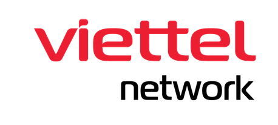

<h1 align="center">The Anh Nguyen</h1>

<p align="center">
  Tech Lead &amp; Solutions Architect, Viettel AI Platform
  <br />
  CNCF Ambassador &amp; Kubestronaut
</p>

<p align="center">
  Building &amp; shaping the AI/GPU Platform @
  
</p>

<p align="center">
  <a href="https://www.linkedin.com/in/ntheanh201/">LinkedIn</a> ·
  <a href="https://ntheanh201.id.vn/">Blog</a> ·
  <a href="https://github.com/ntheanh201">GitHub</a>
</p>

---

## `whoami`

```yaml
apiVersion: cloudnative.io/v1
kind: Engineer
metadata:
  name: the-anh-nguyen
  labels:
    company: viettel-networks
    role: tech-lead/solutions-architect/viettel-ai-platform
    community: cncf-ambassador/kubestronaut
    location: hanoi-vietnam
spec:
  focus:
    - Multi-tenant GPU platform on NVIDIA H200 / NVIDIA AI Enterprise
    - Kubernetes platform engineering on NVIDIA Base Command Manager (BCM)
    - Fractional & multi-tenant GPU (HAMi, MIG, GPU Operator)
    - InfiniBand / GPUDirect RDMA & multi-node NCCL
    - MLOps platforms on Kubernetes (Kubeflow, KServe)
    - LLM inference serving at scale (NVIDIA Dynamo, Token Factory)
  community:
    - kubernetes-org-member
    - project-hami-org-member
    - kubernetes-sig-docs-vi-approver
    - cncf-glossary-vietnamese-lead
```

## Currently

I lead the team building the **Viettel AI Platform** at Viettel Networks and look after its architecture: a
multi-tenant GPU platform and a [Certified Kubernetes AI Platform](https://ntheanh201.id.vn/articles/kubernetes-ai-conformance-viettel-ai-platform.html)
under CNCF's AI Conformance program. Part of it is **Token Factory**, serving LLMs at scale with NVIDIA Dynamo.

```text
gpu fleet     H200 clusters on NVIDIA AI Enterprise + Base Command Manager (BCM)
scheduling    Kubernetes on Base Command Manager (BCM)
              + Slurm-on-Kubernetes (Slinky)
              -> one fleet, both K8s and HPC scheduling
gpu & fabric  GPU Operator + Network Operator: InfiniBand / GPUDirect RDMA,
              multi-node NCCL, HAMi fractional-GPU sharing for multi-tenancy
```

The same platform runs the GPU environments for [Viettel AI Race 2025](https://ntheanh201.id.vn/notes/2025-12-02-viettel-ai-race-2025.html)
and 2026, and the Vietnam AI Open Hackathon 2026 with NVIDIA.

## Recognition

<p align="center">
  <a href="https://www.cncf.io/people/ambassadors/">
    
  </a>
  &nbsp;&nbsp;&nbsp;&nbsp;
  <a href="https://www.credly.com/badges/aac477c8-f802-4264-88ba-0dc84f84e046/linked_in?t=syf2pp">
    
  </a>
  &nbsp;&nbsp;&nbsp;&nbsp;
  <a href="https://ntheanh201.id.vn/articles/kubernetes-ai-conformance-viettel-ai-platform.html">
    
  </a>
  &nbsp;&nbsp;&nbsp;&nbsp;
  <a href="https://www.credly.com/badges/323137e3-08d9-475d-b03e-3dd8f0f3740a">
    
  </a>
  &nbsp;&nbsp;&nbsp;&nbsp;
  <a href="https://www.credly.com/badges/9237fdde-0176-416a-95e0-5c2568599ae4">
    
  </a>
</p>

- [**CNCF Ambassador**](https://www.cncf.io/people/ambassadors/), Cloud Native Computing Foundation
- [**Kubestronaut**](https://www.credly.com/badges/aac477c8-f802-4264-88ba-0dc84f84e046/linked_in?t=syf2pp): CKA · CKAD · CKS · KCNA · KCSA
- **NVIDIA-Certified Professional**: [AI Operations (NCP-AIO)](https://www.credly.com/badges/9237fdde-0176-416a-95e0-5c2568599ae4) · [AI Infrastructure (NCP-AII)](https://credential.nvidia.com/3a8e0b7b-32b6-47bd-a127-49cc8ebc77f5) · [AI Networking (NCP-AIN)](https://credential.nvidia.com/9beb4b0a-85a7-474f-b915-e64161966efa)
- [**Claude Certified Architect – Foundations**](https://www.credly.com/badges/323137e3-08d9-475d-b03e-3dd8f0f3740a), Anthropic
- **The Shubhra Kar Linux Foundation Training (LiFT) Scholarship**, 2025 recipient
- [**Certified Kubernetes AI Platform**](https://ntheanh201.id.vn/articles/kubernetes-ai-conformance-viettel-ai-platform.html), CNCF Kubernetes AI Conformance (v1.35), for the Viettel AI Platform (team)
- [**Silver, 2026 Globee Awards for Artificial Intelligence**](https://ntheanh201.id.vn/notes/2026-05-05-globee-ai-platform-silver.html), GPU-as-a-Service (GPUaaS) & Compute Orchestration, for the Viettel AI Platform (team)
- [**Outstanding Individual, Viettel's global IT line, 2025**](https://ntheanh201.id.vn/notes/2026-06-30-viettel-it-outstanding-individual-2025.html), Viettel Group
- [**Turning GPU-hours into tokens**](https://viettelcloud.vn/en/tech-blog/4/142) is listed in [NVIDIA Dynamo External Publications](https://docs.nvidia.com/dynamo/external-publications)

## Upstream

| Project | What I work on |
|---|---|
| [kai-scheduler/KAI-Scheduler](https://github.com/kai-scheduler/KAI-Scheduler/pulls?q=is%3Apr+author%3Antheanh201+) | NVIDIA DSX OS: Kubernetes-native scheduler for AI workloads |
| [dsx-ai-factory/run-ai](https://github.com/dsx-ai-factory/run-ai/pulls?q=is%3Apr+author%3Antheanh201+) | NVIDIA DSX OS: Run:ai AI workload orchestration platform |
| [dsx-ai-factory/workload-map](https://github.com/dsx-ai-factory/workload-map/pulls?q=is%3Apr+author%3Antheanh201+) | NVIDIA DSX OS: maps framework CRDs into a generic workload structure |
| [NVIDIA/aicr](https://github.com/NVIDIA/aicr/pulls?q=is%3Apr+author%3Antheanh201+) | NVIDIA DSX OS: AI Cluster Runtime (AICR), validated recipes for GPU Kubernetes clusters |
| [NVIDIA/cluster-readiness-engine](https://github.com/NVIDIA/cluster-readiness-engine/pulls?q=is%3Apr+author%3Antheanh201+) | NVIDIA DSX OS: Cluster Readiness Engine (NVCRE) |
| [kubernetes/website](https://github.com/kubernetes/website/pulls?q=is%3Apr+author%3Antheanh201+) | SIG Docs: Vietnamese localization approver, Kubernetes org member |
| [cncf/glossary](https://github.com/cncf/glossary/pulls?q=is%3Apr+author%3Antheanh201+) | Cloud Native Glossary: Vietnamese localization lead |
| [Project-HAMi/HAMi](https://github.com/Project-HAMi/HAMi/pulls?q=is%3Apr+author%3Antheanh201+) | Fractional GPU sharing for Kubernetes, org member |
| [kubeflow/kubeflow](https://github.com/kubeflow/kubeflow/pulls/ntheanh201) | AI platform on Kubernetes |
| [apache/trafficcontrol](https://github.com/apache/trafficcontrol/pulls?q=is%3Apr+author%3Antheanh201+) | Content delivery network; upstreamed the [Grafana Scenes dashboards](https://github.com/apache/trafficcontrol/pull/7927) |

## Talks

I speak at community events in Vietnam. Each talk has a recap on [my blog](https://ntheanh201.id.vn/).

- **Turning GPU-Hours into Tokens, and Tokens into a Service: Agent Router and NVIDIA Dynamo**, [VOI & CNVN x AWS FCAJ Meetup: Cloud & AI Infrastructure](https://ocgroups.dev/cncf/group/d2e22fa/event/5z4fnze), 2026 · [Recap](https://ntheanh201.id.vn/articles/recap-turning-gpu-hours-into-tokens.html)
- **From Project to Production: HAMi and Viettel Cloud**, [KCD & OpenInfra Days Vietnam 2026](https://sessionize.com/view/c0qvrydt/GridSmart) · [Recap](https://ntheanh201.id.vn/articles/recap-kcd-vietnam-2026-hami.html)
- **Auditable Autonomy: Engineering With AI Teammates That Leave a Trace**, The Future of Software Engineering in the Agentic AI era, 2026 · [Recap](https://ntheanh201.id.vn/articles/recap-auditable-autonomy.html)
- **From Vietnam to the World: Contributing to Kubernetes and earning the Linux Foundation Scholarship**, [#cTENcf Birthday Bash Hanoi](https://community.cncf.io/events/details/cncf-cloud-native-hanoi-presents-ctencf-birthday-bash-hanoi/), 2025 · [Recap](https://ntheanh201.id.vn/articles/recap-from-vietnam-to-the-world.html)
- **AI gõ cửa: Doanh nghiệp Việt đã sẵn sàng?**, [VIETTELDX TALKS #8](https://www.youtube.com/watch?v=8pN4ft0OzpY), 2025 · [Recap](https://ntheanh201.id.vn/articles/recap-vietteldx-talks-8.html)
- **HAMi: Fractional GPU for Efficient AI in Cloud Native**, [OpenInfra & Cloud Native Day Vietnam 2025](https://community.cncf.io/events/details/cncf-cloud-native-hanoi-presents-openinfra-amp-cloud-native-day-vietnam-2025/) · [Recap](https://ntheanh201.id.vn/articles/recap-hami-void-2025.html)
- **Fractional GPU for AI: Open Source Solutions in Cloud Native**, [Cloud Native Hanoi May Meetup: GPU and eBPF on Kubernetes](https://community.cncf.io/events/details/cncf-cloud-native-hanoi-presents-may-meetup-gpu-and-ebpf-on-kubernetes/), 2025 · [Recap](https://ntheanh201.id.vn/articles/recap-fractional-gpu-cloud-native-hanoi.html)

## Writing

- [Becoming a Certified Kubernetes AI Platform: notes from our v1.35 submission](https://ntheanh201.id.vn/articles/kubernetes-ai-conformance-viettel-ai-platform.html)
- [Turning GPU-hours into tokens: how Viettel Cloud serves multiple LLM families with NVIDIA Dynamo](https://viettelcloud.vn/en/tech-blog/4/142), Viettel Cloud Tech Blog ([Tiếng Việt](https://viettelcloud.vn/tech-blog/4/142))
- [Apache Traffic Control: migrating Grafana scripted CDN metrics dashboards to Scenes](https://ntheanh201.hashnode.dev/apache-traffic-control-migrating-grafana-scripted-cdn-metrics-dashboards-to-scenes-a-seamless-transition)
- More on [ntheanh201.id.vn](https://ntheanh201.id.vn/)
